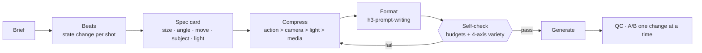

<p align="center">
  
</p>

<h1 align="center">h3-video-prompting</h1>

<p align="center">
  <b>Agent Skill for writing MiniMax H3 / Hailuo 3 video prompts that actually get followed, and don't come out flat.</b>
</p>

<p align="center">
  <b>English</b> · <a href="README.zh-TW.md">繁體中文</a>
</p>

<p align="center">
  <a href="LICENSE"></a>
  
  
  
</p>

---

## Why this skill

Most H3 clips fail for the same few reasons: the prompt describes a *picture* instead of a *timeline*, every shot looks like the one before it, or too much is packed into too few seconds. This skill gives your agent the rules, budgets and templates to avoid that.

- **Motion first.** One main action and one camera move per shot, written as a trajectory with a landing point.
- **Not monotonous.** Cross-shot rules (shot size, angle, move type and subject must change between neighbours), one depth layer and one light path per shot, a planned energy peak.
- **Scenario playbooks.** Dialogue, UGC, MV, dance, fight, product, brand, anime, VFX, loops, editing…
- **Failure triage.** 37 symptoms → cause → fix, plus an 8-question pre-send check.

<p align="center">
  <br>
  <sub>Same scene, four shots. Every neighbouring pair differs in size, angle and subject.</sub>
</p>

## The workflow



The spec card is a **planning tool, not the prompt**. It is compressed into the prompt in priority order, so the word budget (300–700 English words for T2VA) never breaks.

## Before / after

**Flat** — adjectives, three camera moves, no state change:

```text
[Shot 1] A woman sits in a diner, cinematic, dynamic camera, epic lighting.
[Shot 2] At 00:02.000 a close-up, zoom in, pan left, orbit, high quality.
```

**Staged** — a state change, one foreground layer, one light path, one camera move per shot:

```text
[Shot 1] Wide shot through a rain-streaked window, blurred drops in the foreground.
First her phone lights up, then she reads it, as her thumb stops. Red neon through
the wet glass lights only her left cheek. The camera pushes in with small amplitude
at slow speed, ending at the window frame.

[Shot 2] At 00:02.500, the shot cuts to a high-angle close-up of the untouched cup,
her out-of-focus hand in the foreground … The camera holds a static shot.
```

Full walk-through from spec card to a finished three-field prompt: [`example-spec-to-prompt-10s.md`](references/example-spec-to-prompt-10s.md). Converting a Seedance time-coded prompt to H3 format: [`example-seedance-to-h3.md`](references/example-seedance-to-h3.md).

## Install

```bash
# this skill
npx skills add ayase0307/h3-video-prompting

# required: the official formatting skill (field names, <d> tags, Ref2VA six-part layout)
npx skills add https://github.com/MiniMax-AI/MiniMax-H3 --skill h3-prompt-writing
```

Or copy the folder to `~/.claude/skills/h3-video-prompting/` (Claude Code) or your agent's skills directory.

**Division of labour:** `h3-prompt-writing` (official) = final format. `h3-video-prompting` (this repo) = what to write, how to split it, which traps to avoid. Decide content here, format with the official skill.

## What's inside

| File | Covers |
|---|---|
| `SKILL.md` | Workflow, scenario index, budget table, ten quick rules, local ComfyUI notes, red flags |
| `references/shot-variety-and-staging.md` | **New.** 4-axis cross-shot rule, state change per shot, depth, light path, energy curve, pre-send self-check |
| `references/example-spec-to-prompt-10s.md` | **New.** Spec card → 4-shot T2VA prompt, with the variety check worked out |
| `references/example-seedance-to-h3.md` | **New.** Seedance prompt → H3 Ref2VA, every conversion explained |
| `references/camera-and-transitions.md` | 20 official camera moves, shot size / lens / angle, camera motive, rack focus, transitions as events, **camera geometry, continuous vs montage vs two-state camera** |
| `references/long-form-planning.md` | 30–60 s multi-clip planning, seam carriers, spec card, storyboard template |
| `references/scenarios-people.md` | Dialogue, UGC, MV, dance, fight, parkour, comedy, suspense, vlog, POV, digital human |
| `references/scenarios-commercial.md` | Product, unboxing, food, brand film, fashion, logo sting, UI / game, e-commerce |
| `references/scenarios-world-and-styles.md` | B-roll, nature, animals, vehicles, anime, 3D, clay / paper, mixed-media layers, VFX, loops |
| `references/motion-quality.md` | Weight, momentum, materials, hands, faces, lip-sync, slow motion, identity, **movement textures, hero-move budget, negatives with positive replacements** |
| `references/action-choreography.md` | Actions as trajectories, ordering words, one-beat fight formula, **10-element action chain, 3-layer structure, state-machine writing, motifs** |
| `references/rhythm-and-pacing.md` | Timeline, minimum shot length, beat triggers, speed adjectives |
| `references/audio-and-dialogue.md` | Three audio layers, dialogue budget, speaker format, music in / out, audio rule index |
| `references/lighting-and-color.md` | **New.** Lighting and colour wording, cross-shot colour consistency, character relighting, palette-card reference (unverified), post grading and colour QA |
| `scripts/color_qa.py` | **New.** Measures colour difference and dominant colours between shots (stdlib + ffmpeg) |
| `references/audio-pipeline.md` | **New.** One-pass sound + picture and voice-timbre locking, emotion in H3 vs external TTS, dubbing without lip-sync, Openverse SFX with licensing, ffmpeg mixing |
| `references/references-and-editing.md` | Reference roles, motion / camera transfer, video editing, continuation, first / last frame |
| `references/prompt-formats.md` | Official 3-field / 6-part / Chinese 3-part / community block formats, **long self-contained hosted prompts vs this skill's budgets** |
| `references/failure-triage.md` | Symptom → cause → fix table, 8-question pre-send check, 10-question motion director check |
| `references/skin-realism-block.md` | Realistic-skin prompt block |
| `references/example-fight-10s.md` | A full 10 s fight rewrite |
| `references/community-sources.md` | Every source, licence and credibility level |

## Honest limits

Budgets (shots per clip, one move per shot, word counts) come from official guides and community testing. The **cross-shot variety rules, spec card, light path, rack focus and mixed-media layering are method claims** adapted from other models' tutorials and prompt libraries. None has been verified on H3 itself. [`shot-variety-and-staging.md`](references/shot-variety-and-staging.md) §11 lists A/B tests to run on your own rig. Third-party prompts and articles remain the property of their authors; this repo records rules and rewrites, not copies.

## Sources

Official: MiniMax-H3 GitHub / HF guides, the Feishu manual, open-platform docs. Community: AI-KSK, penposs, stimQQ, BeatAPI, fal.ai, Kapwing, Runware, plus Seedance and AI-comic-drama skill repos and Chinese creator tutorials. Full list with licences: [`community-sources.md`](references/community-sources.md).

## License

MIT
