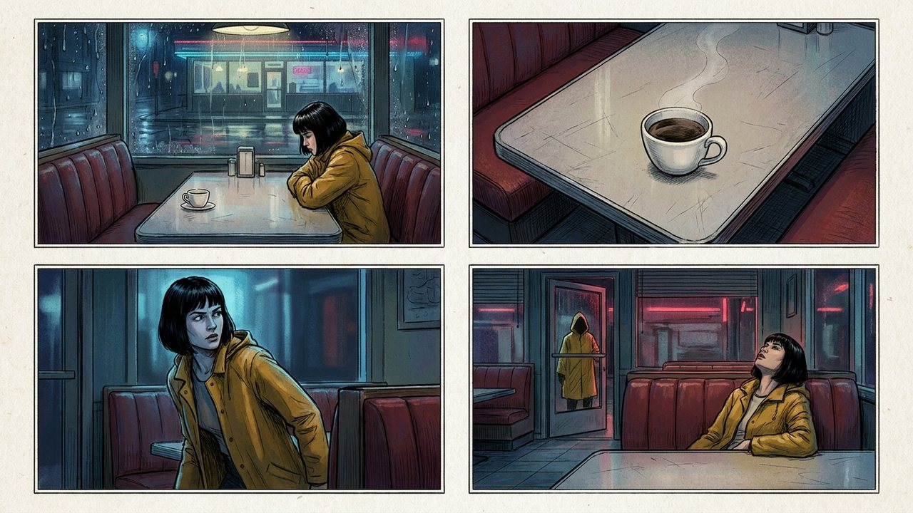
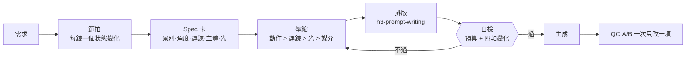

<p align="center">
  
</p>

<h1 align="center">h3-video-prompting</h1>

<p align="center">
  <b>讓 MiniMax H3 / 海螺 3 照著你的提示詞拍、而且不單調的 Agent Skill。</b>
</p>

<p align="center">
  <a href="README.md">English</a> · <b>繁體中文</b>
</p>

<p align="center">
  <a href="LICENSE"></a>
  
  
  
</p>

---

## 為什麼需要這個 skill

H3 影片失敗通常只有幾種原因：提示詞寫的是「一張畫面」而不是「一條時間軸」、每個鏡頭都長得一樣，或在太短的秒數裡塞太多東西。這個 skill 給你的 agent 規則、預算和模板，避開這些坑。

- **動作優先**：每個 shot 一個主動作、一個運鏡，寫成軌跡並給落點。
- **不單調**：跨 shot 規則（相鄰 shot 的景別、角度、運鏡類型、主體必須有變化）、每鏡一個景深層次和一句光線路徑、規劃一個能量高峰。
- **情境手冊**：對白、UGC、MV、舞蹈、打鬥、產品、品牌、動畫、特效、循環、編輯……
- **失敗分診**：37 種症狀 → 原因 → 修法，加上送出前 8 問。

<p align="center">
  <br>
  <sub>同一場戲四個鏡頭：每一對相鄰鏡頭的景別、角度、主體都不同。</sub>
</p>

## 工作流程



Spec 卡是**規劃工具，不是 prompt**。它依優先序壓進 prompt，所以字數預算（T2VA 300–700 英文字）不會爆。

## 前後對照

**平淡**：只有形容詞、三個運鏡、沒有狀態變化：

```text
[Shot 1] A woman sits in a diner, cinematic, dynamic camera, epic lighting.
[Shot 2] At 00:02.000 a close-up, zoom in, pan left, orbit, high quality.
```

**有調度**：有狀態變化、一個前景層次、一句光線路徑、每鏡一個運鏡：

```text
[Shot 1] Wide shot through a rain-streaked window, blurred drops in the foreground.
First her phone lights up, then she reads it, as her thumb stops. Red neon through
the wet glass lights only her left cheek. The camera pushes in with small amplitude
at slow speed, ending at the window frame.

[Shot 2] At 00:02.500, the shot cuts to a high-angle close-up of the untouched cup,
her out-of-focus hand in the foreground … The camera holds a static shot.
```

從 spec 卡到完整三欄 prompt 的示範：[`example-spec-to-prompt-10s.md`](references/example-spec-to-prompt-10s.md)。Seedance 時間碼 prompt 轉 H3 格式：[`example-seedance-to-h3.md`](references/example-seedance-to-h3.md)。

## 安裝

```bash
# 本 skill
npx skills add ayase0307/h3-video-prompting

# 必要的官方排版 skill（欄位名、<d> 標籤、Ref2VA 六段式）
npx skills add https://github.com/MiniMax-AI/MiniMax-H3 --skill h3-prompt-writing
```

或手動把資料夾放進 `~/.claude/skills/h3-video-prompting/`（Claude Code）或你的 agent 的 skills 目錄。

**分工**：`h3-prompt-writing`（官方）= 最終格式；`h3-video-prompting`（本 repo）= 寫什麼、怎麼拆、哪些坑。先用本 skill 決定內容，再用官方 skill 排版。

## 內容

| 檔案 | 內容 |
|---|---|
| `SKILL.md` | 工作流程、情境索引、預算表、十條速查、本地 ComfyUI 注意事項、red flags |
| `references/shot-variety-and-staging.md` | **新增。** 跨 shot 四軸規則、每鏡狀態變化、景深、光線路徑、能量曲線、送出前自檢 |
| `references/example-spec-to-prompt-10s.md` | **新增。** Spec 卡 → 4 shot T2VA prompt，含變化核對過程 |
| `references/example-seedance-to-h3.md` | **新增。** Seedance prompt → H3 Ref2VA，逐項說明轉換 |
| `references/camera-and-transitions.md` | 官方 20 種運鏡、景別／焦段／角度、運鏡動機、焦點轉移、轉場寫成事件 |
| `references/long-form-planning.md` | 30–60 秒多段規劃、接點載體、spec 卡、分鏡表模板 |
| `references/scenarios-people.md` | 對白、UGC、MV、舞蹈、打鬥、跑酷、喜劇、懸疑、vlog、POV、數位人 |
| `references/scenarios-commercial.md` | 產品、開箱、食物、品牌片、時尚、logo 片頭、UI／遊戲、電商 |
| `references/scenarios-world-and-styles.md` | 空鏡、自然、動物、車輛、動畫、3D、黏土紙藝、混合媒介分層、VFX、循環 |
| `references/motion-quality.md` | 重量、動量、材質、手、臉、口型、慢動作、身份保持 |
| `references/action-choreography.md` | 動作寫成軌跡、順序連接詞、打鬥一拍公式 |
| `references/rhythm-and-pacing.md` | 時間軸、shot 最短長度、卡點觸發物、速度形容詞 |
| `references/audio-and-dialogue.md` | 三層音軌、對白預算、speaker 格式、配樂進出、音訊規則索引 |
| `references/audio-pipeline.md` | **新增。** 聲音一次到位與音色鎖定、情緒表演（H3 內 vs 外部 TTS）、無口型配音、Openverse 後製音效與授權、ffmpeg 混音 |
| `references/references-and-editing.md` | 素材分工、動作／運鏡遷移、影片編輯、續接、首尾幀 |
| `references/prompt-formats.md` | 官方三欄／六段式／中文三段／社群區塊式 |
| `references/failure-triage.md` | 症狀 → 原因 → 修法、送出前 8 問 |
| `references/skin-realism-block.md` | 真實皮膚質感段落 |
| `references/example-fight-10s.md` | 完整 10 秒打鬥改寫範例 |
| `references/community-sources.md` | 所有來源、授權與可信度 |

## 誠實的限制

預算（每片 shot 數、每鏡一個運鏡、字數）來自官方指南與社群實測。**跨 shot 變化規則、spec 卡、光線路徑、焦點轉移、混合媒介分層屬於方法主張**，改寫自其他模型的教學與提示詞庫，沒有一條在 H3 上驗證過。[`shot-variety-and-staging.md`](references/shot-variety-and-staging.md) §11 列了可在你自己機器上跑的 A/B 測試。第三方提示詞與文章的版權屬原作者；本 repo 只整理規則與重寫，不收原文。

## 來源

官方：MiniMax-H3 GitHub／HF 指南、飛書手冊、開放平台文件。社群：AI-KSK、penposs、stimQQ、BeatAPI、fal.ai、Kapwing、Runware，以及 Seedance 與 AI 漫劇 skill repo、中文創作者教學。完整清單與授權見 [`community-sources.md`](references/community-sources.md)。

## License

MIT
